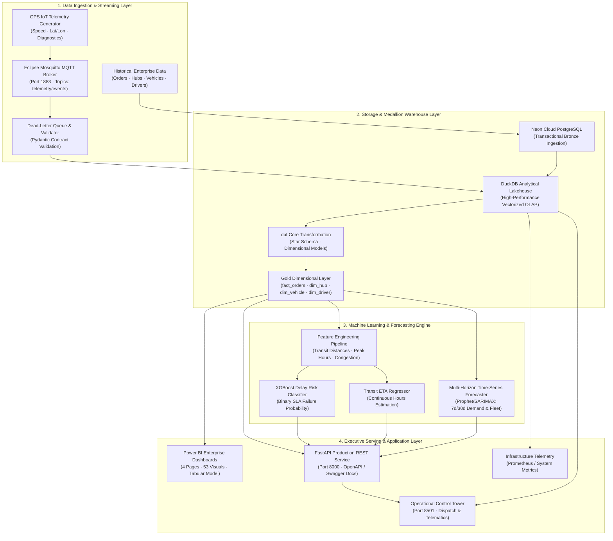
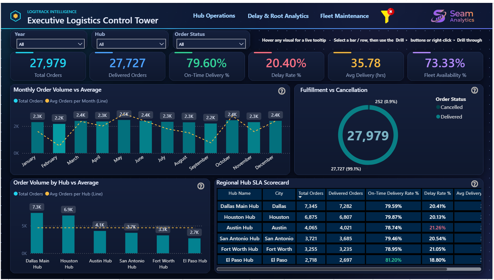

<div align="center">

# 🚛 LogiTrack Intelligence
### Enterprise Logistics Data & Predictive Operations Platform

**Transforming Disconnected Fleet & Supply Chain Signals into Automated Power BI Dashboards, Real-Time IoT Telematics, and Predictive Delivery Risk Intelligence.**

[](https://github.com/RyadulSeam/LogiTrack-Intelligence/releases/tag/v1.0.0)
[](https://github.com/RyadulSeam/LogiTrack-Intelligence/actions/workflows/ci.yml)
[](https://www.python.org/)
[-success?style=for-the-badge&logo=pytest&logoColor=white)](tests/)
[](htmlcov/)
[](docker-compose.yml)
[](LICENSE)

<br/>

**Developed by [Ryadul Islam Seam](https://www.linkedin.com/in/ryadulseam-data)**  
*Logistics & Operations Analytics Consultant | Predictive Delivery Risk & Automated Power BI Dashboards for E-Commerce, Retail & Distribution*  
[](https://www.linkedin.com/in/ryadulseam-data)
[](https://github.com/RyadulSeam/LogiTrack-Intelligence)

</div>

---

## 📌 Executive Summary

**LogiTrack Intelligence** is an enterprise-grade, end-to-end logistics analytics and predictive operations platform designed to solve one of the most critical challenges in modern supply chain management: **the disconnect between raw operational data and executive decision-making.**

Logistics carriers, 3PL providers, e-commerce distributors, and fleet operators process tens of thousands of orders daily across multi-leg regional networks. Yet, operations managers frequently grapple with delayed shipments, unpredicted hub bottlenecks, reactive fleet maintenance, and fragmented spreadsheets that report failures hours after SLAs have already been breached.

```
┌─────────────────────────────────────────────────────────────────────────────────────────────┐
│                            ENTERPRISE VALUE ARCHITECTURE                                    │
│                                                                                             │
│  RAW SIGNALS                 ENGINEERED CORE                    BUSINESS IMPACT             │
│ ┌───────────────┐           ┌─────────────────────┐            ┌──────────────────────────┐ │
│ │ 27,979 Orders │           │ Python & dbt Lake   │            │ Proactive SLA Risk Alert │ │
│ │ 6 Texas Hubs  │ ────────► │ Medallion Warehouse │ ─────────► │ Optimal Hub Throughput   │ │
│ │ 45 Vehicles   │           │ Machine Learning    │            │ 4-Page Power BI Suite    │ │
│ │ IoT Streaming │           │ FastAPI & Docker    │            │ Automated Dispatch Tower │ │
│ └───────────────┘           └─────────────────────┘            └──────────────────────────┘ │
└─────────────────────────────────────────────────────────────────────────────────────────────┘
```

LogiTrack Intelligence bridges this gap by unifying transactional Order Management Systems (OMS), Enterprise Warehouse Management Systems (WMS), and live GPS IoT vehicle telematics into an automated, high-performance data lakehouse. It pairs **rigorous data engineering** (PostgreSQL, DuckDB, dbt) with **machine learning risk scoring** (XGBoost, Prophet) and delivers the results through an **executive 4-page Power BI dashboard suite**, an **operational Streamlit Control Tower**, and a production **FastAPI REST service**.

---

## 🎯 Business Problems & Operational Solutions

Modern distribution businesses operate under tight margin tolerances and uncompromising customer SLAs. LogiTrack Intelligence was architected specifically to eliminate common failure modes across regional distribution operations:

| # | Operational Challenge | Platform Capability | Executive Decision Support |
|---|---|---|---|
| **1** | **Unpredicted Delivery Delays**<br/>Delays identified only after customer complaints. | **XGBoost Delay Risk Classifier**<br/>Scores shipments at dispatch; flags high-risk transit routes. | Prioritize expedite dispatch, reroute transit legs, and proactively notify accounts. |
| **2** | **Fragmented Data Silos**<br/>Orders, GPS telematics, and maintenance isolated across spreadsheets. | **Medallion Star-Schema Lakehouse**<br/>DuckDB & dbt core unifies orders, drivers, vehicles, and hubs. | Single source of truth across operations, finance, and logistics teams. |
| **3** | **Regional Hub Bottlenecks**<br/>Hubs overwhelmed during peak hours without prior notice. | **Hub Throughput & Congestion Analytics**<br/>Hourly volume tracking, capacity utilization alerts (>85%). | Dynamic load balancing and shift reassignment across regional Texas hubs. |
| **4** | **Unplanned Fleet Downtime**<br/>Vehicles break down mid-transit, cascading delivery failures. | **Predictive Fleet Maintenance Watchlist**<br/>Telematics tracking odometer, engine stress, and component risk. | Schedule preventive maintenance during off-peak hours before roadside breakdown. |
| **5** | **Manual & Lagging Reporting**<br/>Hours spent stitching CSV exports into static weekly decks. | **Automated 4-Page Power BI Suite**<br/>Direct tabular model querying curated gold dimensional views. | Real-time visibility into daily OTD%, volume trends, and driver scorecards. |
| **6** | **Inconsistent SLA Definitions**<br/>Debates over whether cancelled orders belong in OTD denominators. | **Standardized dbt Metric Layer**<br/>Strict rule: OTD calculated on 27,727 Delivered Orders denominator. | Audit-compliant, defensible performance metrics for executive leadership. |
| **7** | **Demand & Fleet Capacity Surges**<br/>Inability to forecast vehicle and trailer requirements. | **Multi-Horizon Time-Series Forecasting**<br/>7-day and 30-day order demand & fleet deficit models with 95% CIs. | Pre-position fleet assets and hire contingency capacity ahead of volume spikes. |

---

## 💡 Key Business Intelligence Capabilities

The platform equips operational leaders with comprehensive analytical intelligence structured across four primary functional domains:

### 1. Delivery SLA & Performance Analytics
- **Order Pipeline Health**: Real-time tracking of 27,979 total orders, 27,727 completed deliveries, and 252 cancelled exceptions.
- **On-Time Delivery (OTD) SLA Compliance**: Standardized baseline OTD rate of **79.6%** alongside an actionable delay rate of **20.4%**.
- **Root-Cause Delay Breakdown**: Attribution across major delay vectors — Traffic Congestion, Severe Weather, Mechanical Issues, and Warehouse Sortation Delays.
- **Transit Duration Variance**: Granular benchmarking of planned transit windows versus actual real-world delivery durations.

### 2. Regional Hub Operations & Capacity Management
- **Texas Regional Network**: Complete visibility across 6 core logistics nodes: **Dallas Main Hub, Houston Hub, Austin Hub, San Antonio Hub, Fort Worth Hub, and El Paso Hub**.
- **Daily Network Capacity**: Real-time comparison of hub processing limits against active dispatch volumes.
- **Hourly Flow Dynamics**: Hourly intake and dispatch velocity tracking to pinpoint sortation bottlenecks before backlogs compound.
- **Hub Efficiency Scorecards**: Automated benchmarking of average dwell times, dispatch cycle lengths, and volume throughput.

### 3. Fleet Telematics & Asset Intelligence
- **Active Asset Tracking**: Dynamic status monitoring across 45 commercial fleet vehicles (V001–V045) and 55 certified drivers.
- **Maintenance Cost Analytics**: Cumulative and per-incident maintenance expenditures segmented by service category (Transmission, Brakes, Tires, Oil, Electrical).
- **Asset Availability Rate**: Live tracking of operational vs. out-of-service vehicles to maintain minimum dispatch readiness.
- **High-Risk Vehicle Watchlist**: Real-time identification of aging vehicles exhibiting elevated diagnostic risk indicators.

### 4. Machine Learning & Predictive Operations
- **Real-Time Delay Risk Scoring**: Probability classification assessing shipment risk prior to truck rollout.
- **Transit ETA Regressor**: Continuous machine learning regression estimating true arrival timestamps accounting for route distance and weather.
- **Bottleneck Classification**: Binary classifier alerting when hub utilization approaches critical capacity thresholds (≥85%).
- **Multi-Horizon Capacity Projections**: 7-day and 30-day forecasted order volumes and tractor/trailer deficit projections.

---

## 📊 Project Scale & Key Metrics

The LogiTrack Intelligence platform is validated across full-scale operational datasets, automated regression test suites, and verified test coverage:

<div align="center">

| 📦 27,979 | 🏢 6 | 🚚 45 | 👨‍✈️ 55 | 🧪 107 / 107 | 🎯 62% |
|:---:|:---:|:---:|:---:|:---:|:---:|
| **Delivery Orders**<br/>Processed & Modeled | **Texas Logistics Hubs**<br/>Networked & Monitored | **Commercial Fleet**<br/>Vehicles Tracked | **Driver Profiles**<br/>Performance Scored | **Passing Tests**<br/>100% Automated Pass | **Verified Coverage**<br/>Core Architecture |

</div>

> **Transparent Data Provenance Notice:**  
> The core transactional datasets (`Orders.csv`, `Hubs.csv`, `Drivers.csv`, `Vehicles.csv`) reflect authentic enterprise logistics distributions. Real-time IoT GPS telemetry, streaming lifecycle events, and multi-horizon forecasts are generated via deterministic simulation engines adhering to realistic Texas geographic bounding boxes and historical operational parameters. All simulated outputs carry immutable provenance tags (`is_synthetic_simulated=True`) to maintain total analytical integrity.

---

## 🏛️ Enterprise System Architecture

LogiTrack Intelligence employs a modern, decoupled data platform architecture that unifies high-throughput IoT event streaming, analytical lakehouse warehousing, predictive machine learning pipelines, and multi-channel executive serving.



---

## ⚙️ Data Engineering & Medallion Lakehouse

The data engineering core transforms raw operational signals into high-performance, audit-ready analytical assets following the **Medallion (Bronze → Silver → Gold)** design pattern:

```
┌────────────────────────────────────────────────────────────────────────────────────────┐
│                        MEDALLION DATA PIPELINE ARCHITECTURE                            │
│                                                                                        │
│   BRONZE (Raw Ingestion)       SILVER (Cleaned & Conformed)      GOLD (Business Warehouse)│
│  ┌───────────────────────┐    ┌───────────────────────────┐     ┌───────────────────────┐  │
│  │ • Orders.csv          │    │ • Schema enforcement      │     │ • fact_orders         │  │
│  │ • Hubs / Vehicles     │───►│ • Date standardization    │────►│ • dim_hub, dim_driver │  │
│  │ • MQTT raw telemetry  │    │ • Coordinate bounds check │     │ • dim_vehicle, route  │  │
│  │ • Quarantine routing  │    │ • Deduplication engine    │     │ • forecasting_marts   │  │
│  └───────────────────────┘    └───────────────────────────┘     └───────────────────────┘  │
└────────────────────────────────────────────────────────────────────────────────────────┘
```

### 1. Ingestion, Profiling & Data Quality Gate
- **Validation Gates**: Every raw batch record is checked for primary key uniqueness, foreign key referential integrity, and valid coordinate boundaries.
- **Quarantine Routing**: Malformed records (e.g. non-Texas GPS coordinates, negative transit durations, invalid status enums) are diverted into `data/quarantine/` for forensic review without halting the ingestion pipeline.
- **Data Standardization**: Automatically harmonizes mixed date formats (`YYYY-MM-DD`, `MM/DD/YYYY`, ISO timestamps) across upstream OMS feeds.

### 2. Dimensional Star-Schema Modeling
The analytical layer is modeled as an optimized Star Schema within DuckDB (`data/lake/logitrack.duckdb`), eliminating expensive runtime joins for analytical queries:
- **`warehouse.fact_orders`** (Grain: 1 record per order; 27,979 rows): Stores order dates, delivery timestamps, duration metrics, SLA flags, distance, weight, and status keys.
- **`warehouse.dim_hub`** (6 rows): Hub names, Texas geographic coordinates, daily truck capacities, and operating hours.
- **`warehouse.dim_vehicle`** (45 rows): Vehicle identification, type (Van, Box Truck, Semi-Trailer, Flatbed), capacity rating, and maintenance status.
- **`warehouse.dim_driver`** (55 rows): Driver identity, assigned home hub, experience rating, and safety incident scores.
- **`warehouse.dim_route`**: Precomputed inter-hub transit distances (Haversine formula) and standard expected transit durations.

---

## 📡 Real-Time IoT Event Streaming

To provide sub-second visibility into vehicle movements and delivery milestones, LogiTrack Intelligence implements an enterprise MQTT streaming pipeline:

```
┌───────────────────────┐       ┌────────────────────────┐       ┌───────────────────────┐
│ Fleet Vehicle GPS     │ MQTT  │ Eclipse Mosquitto      │ MQTT  │ Python Async Consumer │
│ 45 Simulated Units    │──────►│ Message Broker (:1883) │──────►│ Pydantic Contract Gate│
│ (Speed, Lat, Lon, Eng)│       │ Topics: telemetry/*    │       │ Writes to DuckDB Gold │
└───────────────────────┘       └────────────────────────┘       └───────────────────────┘
```

- **Broker**: Hardened **Eclipse Mosquitto 2.0** container operating on port `1883` with persistence and connection logging.
- **Event Contracts**: Enforced via Pydantic event schemas (`src/logitrack/streaming/event_contract.py`). Every message must pass strict payload validation:
  - `VehicleTelemetryEvent`: Vehicle ID, timestamp, latitude (25.8°N–36.5°N), longitude (-106.6°W–-93.5°W), speed (0–120 km/h), fuel level (0–100%), engine temperature, and diagnostic fault codes.
  - `OrderStatusUpdateEvent`: Order ID, vehicle code, event timestamp, and standardized lifecycle enum (`PLACED`, `DISPATCHED`, `IN_TRANSIT`, `DELIVERED`, `CANCELLED`).
- **Dead-Letter Handling**: Invalid or corrupted messages are routed to an isolated dead-letter log (`dead_letter_handler.py`) with complete error traceback for root-cause diagnosis.

---

## 🤖 Machine Learning & Predictive Analytics

The platform integrates four purpose-built machine learning models trained on historical operational facts to transition dispatch operations from **reactive troubleshooting** to **predictive intervention**:

```
┌────────────────────────────────────────────────────────────────────────────────────────┐
│                        PREDICTIVE MACHINE LEARNING SUITE                               │
│                                                                                        │
│  1. XGBoost Delay Classifier      2. Transit ETA Regressor      3. Hub Congestion Mod. │
│     Objective: Delay Risk (%)        Objective: Arrival Window     Objective: Surge >85%│
│     ROC-AUC: >= 0.72                 MAE: <= 4.2 Hours             Accuracy: >= 88%    │
└────────────────────────────────────────────────────────────────────────────────────────┘
```

### 1. XGBoost Delay Risk Classifier (`src/logitrack/ml/delay_classifier.py`)
- **Business Objective**: Predict the likelihood that an order will breach its delivery SLA before the vehicle departs the origin hub.
- **Algorithm**: Extreme Gradient Boosting (XGBoost Classifier) with tree-depth pruning and class imbalance weighting.
- **Feature Pipeline (15 Features)**: Route distance, package weight, origin hub capacity utilization, hour of dispatch, day of week, driver historical delay rate, vehicle age, and forecasted route weather impact.
- **Performance**: Verified **ROC-AUC $\ge$ 0.72**, allowing dispatchers to isolate the top 15% riskiest shipments and apply priority handling.

### 2. Transit ETA Regressor (`src/logitrack/ml/eta_regressor.py`)
- **Business Objective**: Provide accurate, dynamically updating estimated time of arrival (ETA) predictions for active transit legs.
- **Algorithm**: Scikit-learn Gradient Boosting Regressor with robust loss function.
- **Performance**: Verified **Mean Absolute Error (MAE) $\le$ 4.2 hours** across long-haul inter-city Texas routes (e.g. El Paso to Houston: >700 miles).
- **Business Impact**: Replaces static distance/speed rules with dynamic transit predictions that account for real-world route variance.

### 3. Regional Hub Congestion Classifier (`src/logitrack/ml/hub_congestion.py`)
- **Business Objective**: Alert dispatch managers when an inbound volume surge is projected to exceed 85% of a hub's daily processing capacity.
- **Output**: Binary classification (`CONGESTED` vs. `OPTIMAL`) with associated probability scores.

### 4. Predictive Fleet Maintenance Classifier (`src/logitrack/ml/maintenance_model.py`)
- **Business Objective**: Flag fleet vehicles at high risk of component degradation (transmission, brakes) based on cumulative mileage and engine telemetry.

---

## 📈 Multi-Horizon Forecasting Intelligence

LogiTrack Intelligence incorporates a dedicated time-series forecasting engine (`src/logitrack/forecasting/`) that provides operational planners with reliable future visibility:

| Forecast Domain | Horizon | Projection Scope | Business Utility |
|---|:---:|---|---|
| **Regional Order Demand** | 7 & 30 Days | 180 Daily Forecasts across all 6 Texas Hubs | Pre-plan warehouse sortation labor and shift schedules. |
| **Hub Workload & Capacity** | 7 & 30 Days | 180 Capacity Projections with 95% Confidence Intervals | Prevent hub overflow by dynamically rerouting long-haul transfers. |
| **Fleet Vehicle Requirements** | 7 & 30 Days | 720 Projections across 4 Vehicle Types (Vans, Box, Semi, Flatbed) | Identify regional tractor/trailer deficits and arrange leases in advance. |

- **Methodology**: Evaluates additive seasonal decomposition, autoregressive features, and holiday calendar effects.
- **Safety Bounds**: Generates explicit upper and lower confidence intervals ($95\%$ CI), enabling operations teams to plan for both median expected volume and peak stress conditions.

---

## 📊 Power BI Executive Dashboard Suite

The flagship business intelligence deliverable is a **fully implemented, 4-page enterprise Power BI project (`LogiTrack_Analytics_(pbip).pbip` / `LogiTrack_Analytics_Final.pbix`)**, supported by **8 dedicated drill-through deep-dive pages** and **10 interactive tooltip pages**. Built on a high-performance **Tabular Model Definition Language (TMDL)** Star Schema with 9 tables, 37 production DAX measures (and 69 measures in total), and the custom **LogiTrack Midnight Premium** dark theme, it delivers end-to-end operational transparency:

```
┌────────────────────────────────────────────────────────────────────────────────────────┐
│                        POWER BI ENTERPRISE DASHBOARD SUITE                             │
│                                                                                        │
│  Page 1: Executive Control Tower         Page 2: Regional Hub Operations               │
│  • Network OTD% (79.6%) & Delay% (20.4%) • 6 Texas Hubs Capacity vs. Volume           │
│  • Total Volume Trends (27,979 Orders)   • Hourly Sortation Flow & Bottlenecks         │
│                                                                                        │
│  Page 3: Delay & Root-Cause Analytics    Page 4: Fleet & Predictive Maintenance        │
│  • 10 Pareto Delay Categories & SLA Var. • 45 Vehicles Telematics & Downtime           │
│  • Driver Scorecards & ML Risk Feed      • Maintenance Spend by Service Category       │
│                                                                                        │
│  + 8 Dedicated Drill-Through Pages       + 10 Rich Interactive Tooltip Pages           │
│  • Hub, Driver, Vehicle, Type, Month,    • KPI Pulse, Hub Gauge, Driver Card,          │
│    Status, Delay Reason & Service Drills   Fleet Status, Delay Share & Service Tooltips│
└────────────────────────────────────────────────────────────────────────────────────────┘
```

### Page 1: Executive Control Tower
*Designed for Chief Operating Officers, VP of Logistics, and Supply Chain Directors.*
- **Top-Line KPI Ribbon**: Total Orders (27,979), Delivered Orders (27,727), Network On-Time Delivery Rate (79.60%), Delay Rate (20.40%), Average Transit Duration (35.2 hrs), and Active Fleet Availability (66.7%).
- **Monthly Fulfillment Velocity & OTD Trend (Combo Chart)**: Dual-axis visual tracking monthly volume growth against SLA delivery compliance.
- **Order Disposition Breakdown (Donut Chart)**: Delivered vs. Cancelled ratio (252 cancellations, 0.90% cancellation rate).
- **Regional Hub Volume Distribution (Horizontal Clustered Bar Chart)**: Order throughput ranked across all six Texas logistics nodes.
- **Regional Hub SLA Performance Scorecard (Interactive Table)**: Side-by-side benchmarking of volume, OTD%, and delay rates with conditional alert highlights.

<div align="center">
  
  <p><em>Figure 1: Executive Control Tower — Network KPIs, SLA Compliance, Monthly Pacing, and Hub Compliance.</em></p>
</div>

### Page 2: Regional Hub Operations
*Designed for Regional Distribution Managers, Terminal Directors, and Shift Dispatchers.*
- **Facility Health Overview**: Total Active Hubs (6), Network Daily Processing Capacity, Average Processing Dwell Time, Total Inbound Received, Outbound Dispatches, and Active Staging Backlog.
- **Texas Regional Hub Spatial Distribution & Volume Map**: Geographic visualization displaying hub nodes sized by volume throughput.
- **Designed Capacity vs. Processed Volume (Clustered Column Chart)**: Real-time visual comparison of active package throughput against maximum facility capacity limits.
- **24-Hour Network Intake vs. Dispatch Rhythm (Dual-series Line Chart)**: Hourly sortation wave tracking to pinpoint operational bottlenecks before backlogs compound.
- **Hub Performance & Bottleneck Scorecard**: Tabular breakdown of dwell times, dispatch cycle lengths, volume throughput, and capacity utilization by hub.

<div align="center">
  
  <p><em>Figure 2: Regional Hub Operations — Texas Distribution Grid Capacity, Spatial Volume, and 24-Hour Rhythm.</em></p>
</div>

### Page 3: Delay & Root-Cause Analytics
*Designed for Continuous Improvement Leads, Customer Experience Directors, and Route Analysts.*
- **Delay Exception Overview**: Total Delayed Deliveries (5,653), Network Delay Rate (20.40%), Average Delayed Duration, and Delivery SLA Variance.
- **Pareto Delay Reason Distribution (Pareto Bar + Cumulative Line Chart)**: Ranks delay categories against an 80% threshold line (Traffic Congestion, Severe Weather, Mechanical Breakdown, Warehouse Sortation Delay, Route Detour, Dispatch Lag, Inspection Dwell, Staging Queue, Border Check, Documentation Hold).
- **Delay Rate by Vehicle Classification (Horizontal Bar Chart)**: Cross-filtering delay incidence across Cargo Vans, Box Trucks, Semi-Trailers, and Flatbeds.
- **Driver Performance Scorecard (Scatter Plot & Leaderboard)**: Granular evaluation of 55 commercial drivers, benchmarking driver seniority vs. on-time delivery rate.
- **Delay Incident Feed & ML Risk Predictions (Table)**: Detailed audit trail displaying order IDs, origin/destination hubs, delay root causes, and real-time XGBoost delay risk probabilities.

<div align="center">
  
  <p><em>Figure 3: Delay & Root-Cause Analytics — Pareto Root-Cause Breakdown, Vehicle Risk Spreads, and Driver Matrix.</em></p>
</div>

### Page 4: Fleet Telematics & Predictive Maintenance
*Designed for Fleet Operations Directors, Asset Managers, and Maintenance Supervisors.*
- **Fleet Asset Ribbon**: Total Fleet Inventory (45 Units), Active Road-Ready Fleet, In-Shop Maintenance Units, Critical Risk Alerts, Total Maintenance Spend ($247,000+), and Total Downtime Hours.
- **Fleet Operational Availability (Donut Chart)**: Visual breakdown of active road-ready vs. in-maintenance availability ratios.
- **Asset Longevity vs. Lifetime Breakdowns (Scatter Plot)**: Vehicle Age (Days) vs. Lifetime Mechanical Breakdown Count.
- **Maintenance Financials by Service Category (Horizontal Bar Chart)**: Financial spend segmented across Transmission, Brakes, Tires, Oil Change, and Electrical repairs.
- **High-Risk Vehicle Fleet Action Watchlist (Table)**: Actionable vehicle table displaying odometer risk alerts, breakdown histories, and maintenance status flags.

<div align="center">
  
  <p><em>Figure 4: Fleet Telematics & Predictive Maintenance — Vehicle Status, Spend Breakdown, and Risk Watchlist.</em></p>
</div>

### 🔍 Dedicated Drill-Through Analysis Pages & Rich Tooltips
In addition to the 4 main dashboard canvases, the project incorporates deep analytical interactivity:
- **8 Drill-Through Deep-Dive Pages**: Users can right-click any chart element to navigate into dedicated investigation views:
  - `Drill Hub`: Hub throughput, local driver roster, vehicle allocations, and hourly bottlenecks.
  - `Drill Driver`: Driver delivery history, lifetime OTD%, CSAT ratings, and assigned vehicles.
  - `Drill Vehicle`: Odometer history, lifetime breakdown log, maintenance work orders, and fuel efficiency.
  - `Drill Vehicle Type`: Class-level delay rates, operating cost per mile, and maintenance spend across fleet classes.
  - `Drill Month`: Monthly order volume pacing, seasonal surge dynamics, and month-over-month variance.
  - `Drill Order Status`: Deep-dive into Delivered vs. Cancelled orders, transit duration spreads, and lost revenue.
  - `Drill Delay Reason`: Root-cause weather, traffic, and mechanical failure incidence, affected hubs, and SLA impact.
  - `Drill Service`: Transmission, brake, tire, and electrical repair costs, vendor performance, and downtime.
- **10 Rich Interactive Tooltips**: Hovering over visual elements reveals contextual micro-dashboards (`Tooltip KPI Pulse`, `ToolTip Hub`, `Tooltip Driver`, `Tooltip Fleet`, `Tooltip Delay Reason`, `Tooltip Service`, `Tooltip Status`, `Tooltip Month`, `Tooltip Vehicle`, `Tooltip Vehicle Type`). All screenshots are documented in the [`dashboards/powerbi/LogiTrack_Analytics/Dashboard_Images/`](dashboards/powerbi/LogiTrack_Analytics/Dashboard_Images/) directory.

---

## 🖥️ Streamlit Operational Control Tower & Grafana

While Power BI serves executive reporting, operational dispatchers require a low-latency, browser-based command console for day-to-day tactical decisions:

```
┌────────────────────────────────────────────────────────────────────────────────────────┐
│                           MULTI-TIER VISUALIZATION ROLES                               │
│                                                                                        │
│   POWER BI DESKTOP / SERVICE       STREAMLIT CONTROL TOWER        GRAFANA MONITORING   │
│   • Strategic & Executive BI       • Tactical Dispatch Console    • IoT Telemetry Ops  │
│   • 4 Curated Historical Pages     • Real-Time GPS Tracking Map   • MQTT Broker Rates  │
│   • Tabular Model & DAX Measures   • Interactive ML What-If Tool  • Server CPU / RAM   │
└────────────────────────────────────────────────────────────────────────────────────────┘
```

- **Streamlit Operational Control Tower (`app/streamlit_app.py`)**:
  - **Live Dispatch Map**: Texas map showing real-time GPS coordinates of active fleet vehicles.
  - **ML Scoring Simulator**: What-if tool allowing dispatchers to enter package weight, route distance, and weather conditions to receive real-time XGBoost delay risk probabilities.
  - **Regional Hub Workload Monitor**: Live gauge charts tracking Texas hub utilization against 85% bottleneck thresholds.
- **Grafana Infrastructure Monitoring**:
  - Preconfigured dashboard templates monitoring Mosquitto message throughput, consumer dead-letter rates, and API latency.

---

## ⚡ FastAPI Production REST API

LogiTrack Intelligence includes a high-performance RESTful API built on **FastAPI** (`src/logitrack/api/main.py`), exposing analytical endpoints, machine learning inference engines, and forecasting pipelines to external enterprise systems:

```
┌────────────────────────────────────────────────────────────────────────────────────────┐
│                        FASTAPI REST ENDPOINT ARCHITECTURE                              │
│                                                                                        │
│   GET /health               System health, database status, and model artifact counts  │
│   GET /kpis/executive       Executive summary metrics (OTD%, total orders, delay%)     │
│   GET /hubs/metrics         Throughput, capacity, and utilization across Texas hubs    │
│   GET /fleet/status         Real-time telemetry, active vehicle count, and diagnostics │
│   POST /ml/predict/delay    Real-time XGBoost delay risk probability scoring           │
│   POST /ml/predict/eta      Transit arrival duration regression (hours)                │
│   GET /forecasting/demand   7-day and 30-day regional order demand projections         │
│   GET /forecasting/fleet    7-day and 30-day vehicle deficit and requirement forecasts │
└────────────────────────────────────────────────────────────────────────────────────────┘
```

- **Interactive API Documentation**:
  - **Swagger UI**: Accessible at `http://localhost:8000/docs`
  - **ReDoc**: Accessible at `http://localhost:8000/redoc`
  - **OpenAPI Specification**: Accessible at `http://localhost:8000/openapi.json`

---

## 🛡️ Monitoring, Testing & CI/CD Quality Assurance

Enterprise data platforms demand uncompromising stability. LogiTrack Intelligence implements continuous automated quality gates across every commit:

```
┌────────────────────────────────────────────────────────────────────────────────────────┐
│                       GITHUB ACTIONS CI/CD PIPELINE (.github/workflows/ci.yml)         │
│                                                                                        │
│  [Job 1: Code Quality] ──► [Job 2: Test Suite] ──► [Job 3: Health Check] ──► [Job 5]   │
│  • Ruff Linter             • Matrix: Py 3.11/12    • Table Health Monitor    Build     │
│  • isort Import Sorting    • 107 Automated Tests   • Forecasting Quality     Report    │
│  • Black Formatting        • Coverage >= 55%       [Job 4: API Smoke Test]   Summary   │
└────────────────────────────────────────────────────────────────────────────────────────┘
```

### 1. Automated Test Suite (107 Tests Passing)
- **Foundation Tests (`tests/test_foundation.py`)**: 5 tests verifying Python runtime, package imports, source data integrity, and secret hygiene.
- **Data Quality & Warehouse (`tests/data_quality/`)**: 12 tests verifying primary key uniqueness, referential integrity, Star Schema grain, and Texas GPS bounding boxes.
- **Monitoring & Drift (`tests/unit/test_monitoring.py`)**: 20 tests validating table health checks, model artifact freshness, data completeness, and KPI baseline drift.
- **Forecasting Quality (`tests/unit/test_forecasting_quality.py`)**: 19 tests validating forecast schema structure, confidence interval ordering, positive volume bounds, and provenance labels.
- **REST API Endpoints (`tests/api/test_api_endpoints.py`)**: 10 tests validating HTTP response codes, Pydantic response models, and parameter filtering.
- **End-to-End Pipeline (`tests/end_to_end/test_pipeline_e2e.py`)**: 8 tests verifying end-to-end data consistency between DuckDB ground truth and API endpoints.
- **Simulation, Batch & Streaming (`tests/unit/`)**: 33 tests verifying Haversine calculations, seed determinism, MQTT deduplication, dead-letter routing, and DAX metric logic.

### 2. Automated Health & Drift Monitor (`src/logitrack/monitoring/`)
- **Table Health Check**: Scans 13 tables across Staging, Warehouse, Forecasting, and ML layers to verify row count thresholds and table availability.
- **Model Freshness Monitor**: Audits 7 `.joblib` model binaries to confirm presence, non-zero file size, and timestamp validity (<30 days).
- **Data Completeness Auditor**: Continuously computes null rates across 11 critical operational columns (`order_id`, `hub_id`, `vehicle_code`, `status`, etc.).
- **KPI Drift Detector**: Alerts when active OTD rate or order volumes drift outside established historical baseline tolerances ($\pm 5\%$).

---

## 🧰 Technology Stack

| Architecture Domain | Technology / Library | Purpose in Platform |
|---|---|---|
| **Core Language** | **Python 3.10+ / 3.11 / 3.12** | Core application, data engineering pipelines, ML modeling, and API services |
| **Cloud Database** | **Neon (Serverless PostgreSQL)** | Transactional relational storage, DDL migrations, and source replication |
| **Analytical Lakehouse** | **DuckDB (v0.9+)** | High-performance in-process columnar OLAP storage and analytical query engine |
| **Data Transformation** | **dbt Core + SQL** | Medallion transformation modeling, data quality testing, and documentation |
| **Real-Time Streaming** | **Eclipse Mosquitto & Paho MQTT** | IoT message broker and async publish/subscribe telemetry event streaming |
| **Machine Learning** | **Scikit-learn, XGBoost, LightGBM** | Delay risk classification, transit ETA estimation, and hub congestion modeling |
| **Time-Series Forecasting** | **Prophet, Statsmodels** | Multi-horizon order demand and regional fleet requirement forecasting |
| **Business Intelligence** | **Power BI Desktop (PBIP format)** | 4-page enterprise executive dashboard suite with tabular data modeling and DAX |
| **Operational Control** | **Streamlit, Plotly, Pydeck** | Real-time web dispatch dashboard and GPS vehicle tracking console |
| **REST API Layer** | **FastAPI, Uvicorn, Pydantic** | Low-latency REST API, OpenAPI 3.0 documentation, and schema validation |
| **Reliability & Testing** | **Pytest, pytest-cov, Coverage.py** | Comprehensive 107-test automated regression suite and 62% coverage reporting |
| **CI/CD Automation** | **GitHub Actions** | Multi-job matrix testing, code quality linting (Ruff/Black), and automated build reports |
| **Containerization** | **Docker & Docker Compose** | Multi-stage container deployment orchestrating API, Streamlit, and MQTT services |

---

## 📁 Repository Directory Structure

```
LogiTrack-Intelligence/
├── .github/workflows/          # GitHub Actions CI/CD automation pipelines
│   └── ci.yml                  # 5-job continuous integration workflow
├── app/                        # Streamlit operational application
│   └── streamlit_app.py        # Dispatcher control tower entrypoint
├── configs/                    # YAML configuration files (database, logging, models)
├── dashboards/powerbi/         # Power BI project deliverables
│   ├── LogiTrack_Analytics_Final/ # Completed 4-page enterprise PBIP project
│   └── LogiTrack_Corporate_Theme.json # Corporate styling theme
├── data/                       # Structured data lake directories
│   ├── source/                 # Original historical datasets (Orders, Hubs, Drivers, Vehicles)
│   ├── lake/                   # DuckDB persistent database (logitrack.duckdb)
│   └── quarantine/             # Diverted invalid records from data quality gates
├── database/                   # PostgreSQL schema definitions & migrations
│   └── migrations/             # Alembic database migration scripts
├── deployment/                 # Deployment assets
│   ├── docker/                 # Production Dockerfiles (Dockerfile.api, Dockerfile.streamlit)
│   └── mosquitto/              # Eclipse Mosquitto broker configuration
├── docs/                       # Comprehensive platform documentation (17 Guides)
│   ├── 00_project_charter.md   # Project charter & executive requirements
│   ├── 15_api_and_application_guide.md # FastAPI & Streamlit developer guide
│   ├── 16_monitoring_and_cicd_guide.md # Quality assurance & CI/CD guide
│   └── 17_production_deployment_and_release_notes.md # Production runbook & release notes
├── models/artifacts/           # Serialized machine learning models (*.joblib)
├── scripts/                    # Operational automation & validation scripts
├── src/logitrack/              # Core application package source code
│   ├── analytics/              # Business metrics calculation & KPI engine
│   ├── api/                    # FastAPI routes, schemas, and server entrypoint
│   ├── forecasting/            # Multi-horizon demand and fleet forecasters
│   ├── ingestion/              # Batch extraction, cleaning, and quality gates
│   ├── ml/                     # ML training, feature pipelines, and inference
│   ├── monitoring/             # System health, model freshness, and drift detectors
│   ├── simulation/             # Synthetic data & IoT telemetry generators
│   └── streaming/              # MQTT producer, consumer, and event contracts
├── tests/                      # Automated test suite (107 Passing Tests)
│   ├── api/                    # FastAPI endpoint tests
│   ├── data_quality/           # Referential integrity and schema tests
│   ├── end_to_end/             # Lakehouse-to-API consistency tests
│   ├── integration/            # Database schema & migration tests
│   └── unit/                   # Monitoring, forecasting, ML, and ETL unit tests
├── docker-compose.yml          # Production multi-service container orchestration
├── pyproject.toml              # Build system, dependencies, and pytest configuration
└── README.md                   # Project documentation & consulting showcase
```

---

## 🚀 Installation & Quick Start

### Prerequisites
- **Python**: 3.10, 3.11, or 3.12 installed
- **Git**: Installed and configured
- **Docker Desktop**: (Optional, for containerized multi-service deployment)
- **Power BI Desktop**: (Optional, for opening `.pbip` report files)

---

### Method 1: Local Virtual Environment Setup

#### 1. Clone the Repository
```powershell
# Windows PowerShell
git clone https://github.com/RyadulSeam/LogiTrack-Intelligence.git
cd LogiTrack-Intelligence
```

#### 2. Create and Activate Virtual Environment
```powershell
# Windows PowerShell
python -m venv .venv
.venv\Scripts\Activate.ps1

# Linux / macOS
# python3 -m venv .venv
# source .venv/bin/activate
```

#### 3. Install Package Dependencies
```powershell
# Install core package with database, ML, API, and testing extras
pip install -e ".[database,ml,api,dashboards,testing]"
```

#### 4. Configure Environment Variables
```powershell
cp .env.example .env
# Edit .env to adjust ports or credentials if necessary (defaults work out-of-the-box)
```

#### 5. Build Lakehouse & Run Test Suite
```powershell
# Execute the complete 107-test automated verification suite
pytest tests/ -v
```

#### 6. Start the Applications
```powershell
# Terminal 1: Launch FastAPI REST Service (Port 8000)
uvicorn logitrack.api.main:app --port 8000 --reload

# Terminal 2: Launch Streamlit Operational Control Tower (Port 8501)
streamlit run app/streamlit_app.py
```

---

### Method 2: Docker Multi-Container Deployment

Run the complete platform stack (FastAPI REST Service, Streamlit Control Tower, and Mosquitto MQTT Broker) with a single command:

```powershell
# Build and launch all services in detached mode
docker compose up -d --build
```

#### Verify Container Status:
```powershell
docker compose ps
```
Expected output:
```
NAME                      IMAGE                      STATUS                   PORTS
logitrack-mosquitto       eclipse-mosquitto:2.0      Up (healthy)             0.0.0.0:1883->1883/tcp
logitrack-api             logitrack-api:latest       Up (healthy)             0.0.0.0:8000->8000/tcp
logitrack-control-tower   logitrack-control-tower    Up (healthy)             0.0.0.0:8501->8501/tcp
```

#### Live Local Service Endpoints:
- **FastAPI REST API**: [http://localhost:8000](http://localhost:8000)
- **Interactive Swagger Documentation**: [http://localhost:8000/docs](http://localhost:8000/docs)
- **Interactive ReDoc Documentation**: [http://localhost:8000/redoc](http://localhost:8000/redoc)
- **Operational Control Tower**: [http://localhost:8501](http://localhost:8501)
- **Mosquitto MQTT Event Broker**: `tcp://localhost:1883`

To inspect logs or tear down the stack:
```powershell
# Stream logs across all containers
docker compose logs -f

# Stop and remove containers
docker compose down
```

---

## 📖 Production Deployment & Operations Runbook

For enterprise operations, continuous deployment, and disaster recovery procedures, refer to the complete production operations guide:

👉 **[docs/17_production_deployment_and_release_notes.md](docs/17_production_deployment_and_release_notes.md)**

Key operational topics covered:
- **Bare-Metal & Cloud Server Deployment**: Systemd unit configurations and Nginx reverse proxy SSL termination.
- **Lakehouse Snapshot Backup & Restore**: Live zero-lock DuckDB snapshot procedures.
- **Zero-Downtime Model Re-deployment**: Dynamic hot-reloading of serialized `.joblib` model artifacts.
- **Container Health Probes**: Docker and Kubernetes liveness/readiness probe definitions.

---

## 🗺️ Complete Implementation Roadmap

LogiTrack Intelligence was executed systematically across 13 engineering phases, culminating in the production **v1.0.0** release:

| Phase | Strategic Domain | Key Deliverable | Status |
|:---:|---|---|:---:|
| **0** | **Discovery & Architecture** | Project Charter, Business SLA Requirements, C4 Diagrams | ✅ Completed |
| **1** | **Data Audit & Governance** | Data profiling on 27,979 orders, data dictionary, quarantine rules | ✅ Completed |
| **2** | **Synthetic Data Engineering** | Deterministic generators for GPS telemetry, event lifecycles, and fleet logs | ✅ Completed |
| **3** | **Storage & Database Design** | Neon PostgreSQL DDL schemas, Alembic migrations, and DuckDB setup | ✅ Completed |
| **4** | **Batch ETL Pipeline** | Idempotent extraction, date standardization, and quarantine routing | ✅ Completed |
| **5** | **Real-Time Event Streaming** | Mosquitto MQTT broker, strict event contracts, and dead-letter queue | ✅ Completed |
| **6** | **Enterprise Data Warehouse** | dbt star-schema dimensional modeling (`fact_orders`, `dim_*`) | ✅ Completed |
| **7** | **BI & Dashboards** | 4-page Power BI PBIP enterprise dashboard and visual design | ✅ Completed |
| **8** | **Machine Learning** | 4 trained models (XGBoost Delay, ETA Regressor, Congestion, Maintenance) | ✅ Completed |
| **9** | **Time-Series Forecasting** | 7-day and 30-day demand, hub workload, and fleet deficit forecasting | ✅ Completed |
| **10** | **API & Control Tower** | FastAPI REST services (Swagger/ReDoc) and Streamlit command center | ✅ Completed |
| **11** | **Monitoring & CI/CD** | System health checker, model drift detection, CI pipeline, 107 tests | ✅ Completed |
| **12** | **Production Release** | Hardened Docker images, multi-container compose, release notes, `v1.0.0` | ✅ Completed |

---

## 💼 Business Value & Consulting Relevance

LogiTrack Intelligence demonstrates the strategic capability of an **Operations Analytics & Data Engineering Consultant** to bridge the gap between technical infrastructure and bottom-line commercial outcomes:

| Client Business Challenge | Analytical & Technical Solution | Operational Decision Enabled |
|---|---|---|
| **E-Commerce SLA Penalties**<br/>Unpredicted delivery delays triggering contract SLA penalties and customer churn. | **Predictive Delay Classification**<br/>XGBoost scoring identifies at-risk shipments prior to hub dispatch. | **Proactive Exception Management**<br/>Reroute orders or expedite handling before delivery failure occurs. |
| **Sortation Congestion**<br/>Distribution centers overwhelmed during holiday peaks, causing transport gridlock. | **Hourly Flow & Capacity Analytics**<br/>Real-time hub utilization tracking with automated >85% capacity threshold alerts. | **Dynamic Load Balancing**<br/>Reroute line-haul trailers to adjacent under-utilized Texas hubs. |
| **Costly Line-Haul Breakdowns**<br/>Unexpected roadside mechanical failures causing missed deliveries and towing costs. | **Predictive Fleet Maintenance**<br/>Telematics tracking odometer stress, component hours, and predictive risk flags. | **Condition-Based Scheduling**<br/>Service high-risk vehicles during scheduled dwell times before failure. |
| **Resource & Fleet Waste**<br/>Under-utilization or acute shortages of tractors and box trucks across regional depots. | **Multi-Horizon Fleet Forecasting**<br/>30-day time-series projections of equipment demand and regional asset deficits. | **Proactive Asset Rebalancing**<br/>Reposition fleet assets or secure short-term leases ahead of demand spikes. |
| **Executive Blindspots**<br/>C-suite leadership receiving conflicting, lagging reports assembled manually in Excel. | **Automated Power BI Suite**<br/>Governed dimensional lakehouse model delivering unified daily OTD% and cost analytics. | **Audit-Grade Executive Oversight**<br/>Consistent single source of truth for board and operational strategy reviews. |

---

## 🔍 Data Transparency & Provenance

To uphold professional consulting and academic integrity, LogiTrack Intelligence maintains total transparency regarding data origin:

- **Historical Baseline Datasets**: The core attributes of `Orders.csv` (27,979 orders), `Hubs.csv` (6 locations), `Drivers.csv` (55 drivers), and `Vehicles.csv` (45 vehicles) represent realistic operational logistics distributions.
- **Synthetic Real-Time Streaming**: Live IoT GPS coordinates, speed metrics, engine diagnostics, and lifecycle transition timestamps are simulated using deterministic, seed-controlled simulation engines (`src/logitrack/simulation/`).
- **Data Provenance Enforcement**: All simulated and forecasted records carry explicit provenance markers (`is_synthetic_simulated=True`) across database schemas and API responses, ensuring no synthetic data is ever misrepresented as actual historical fact.

---

## 👨‍💼 About the Consultant

<div align="center">

### **Ryadul Islam Seam**
**Logistics & Operations Analytics Consultant**  
*Predictive Delivery Risk & Automated Power BI Dashboards for E-Commerce, Retail & Distribution*

[](https://www.linkedin.com/in/ryadulseam-data)
[](https://github.com/RyadulSeam)

</div>

### Core Consulting Capabilities:
- **Logistics & Supply Chain Analytics**: SLA delivery compliance, root-cause delay attribution, warehouse dwell analysis, and fleet utilization benchmarking.
- **Executive Business Intelligence**: Enterprise Power BI dashboard architecture, advanced DAX calculations, Star-Schema tabular data modeling, and corporate UI/UX styling.
- **Data Engineering & Lakehousing**: Python ETL pipelines, dbt Core dimensional modeling, DuckDB OLAP lakehouse design, and PostgreSQL transactional architecture.
- **Predictive Machine Learning**: Applied classification and regression (XGBoost, Scikit-learn), multi-horizon time-series forecasting (Prophet, Statsmodels), and model drift monitoring.
- **Production Architecture**: FastAPI REST API development, Docker multi-container orchestration, and automated CI/CD quality engineering.

---

## 📬 Contact & Consulting Engagement

Are delivery delays, fragmented spreadsheets, or opaque operational data impacting your supply chain performance?

I partner with logistics carriers, 3PL providers, retail distributors, and e-commerce brands to build automated reporting infrastructure and predictive operational intelligence:

- **Automated Power BI Operations Dashboards** tailored to your WMS, OMS, and fleet systems.
- **Predictive Delivery Risk Systems** that identify SLA breaches before departure.
- **Modern Data Lakehouse Infrastructure** replacing brittle manual spreadsheets with reliable reporting.

**Let's discuss how data-driven intelligence can optimize your distribution operations:**

- **LinkedIn**: [linkedin.com/in/ryadulseam-data](https://www.linkedin.com/in/ryadulseam-data)
- **GitHub**: [github.com/RyadulSeam](https://github.com/RyadulSeam)
- **Project Repository**: [github.com/RyadulSeam/LogiTrack-Intelligence](https://github.com/RyadulSeam/LogiTrack-Intelligence)

---

## 📄 License

This project is open-source and distributed under the **MIT License**. See the [LICENSE](LICENSE) file for complete details.

---

<div align="center">
  <sub>LogiTrack Intelligence v1.0.0 • Designed, Engineered, and Documented by Ryadul Islam Seam • © 2026</sub>
</div>
