# 🚛 LogiTrack Intelligence — Enterprise Power BI Operational Suite
**Master Release Version:** `v1.0.0 (Production Release)`  
**Project Path:** `dashboards/powerbi/`  
**Master PBIP Project:** `dashboards/powerbi/LogiTrack_Analytics/LogiTrack_Analytics_(pbip).pbip`  
 **Master Corporate Theme:** `dashboards/powerbi/LogiTrack_Premium_Theme.json`  
**DAX Measures Library:** `dashboards/powerbi/dax_measures.txt`  
**SQL Semantic Views:** `dashboards/powerbi/semantic_views.sql`  

---

## 1. Executive Summary

The **LogiTrack Intelligence Power BI Analytics Suite** is an enterprise-grade reporting and operational command solution designed for Chief Operating Officers, Supply Chain Directors, Regional Hub Managers, and Fleet Dispatchers.

Built on Microsoft Power BI's modern **Tabular Model Definition Language (TMDL)** and **PBIP (Power BI Project)** format, the solution unifies **27,979 multi-leg delivery orders**, **6 Texas regional distribution hubs**, **45 commercial fleet vehicles**, and **55 certified drivers** into an automated, interactive intelligence environment.

```
dashboards/powerbi/
├── LogiTrack_Analytics/                      # Master Power BI Project Environment
│   ├── LogiTrack_Analytics_(pbip).pbip       # Primary PBIP project entrypoint
│   ├── LogiTrack_Analytics_Final.pbix        # Standalone self-contained binary report
│   ├── Dashboard_Images/                     # High-resolution dashboard page screenshots
│   ├── LogiTrack_Analytics_(pbip).Report/    # Modern PBIR report visual definitions
│   └── LogiTrack_Analytics_(pbip).SemanticModel/ # TMDL tabular semantic model definitions
├── data_export/                              # Clean warehouse export tables (CSV data sources)
├── dax_measures.txt                          # Production DAX measures reference library (37+ measures)
├── LogiTrack_Premium_Theme.json              # "LogiTrack Midnight Premium" corporate theme
├── README.md                                 # Master technical architecture guide
└── semantic_views.sql                        # SQL semantic layer analytical views
```

---

## 2. The 4 Primary Executive & Operational Dashboard Pages

The platform delivers four core analytical pages, structured to guide leadership from high-level network performance down to granular root-cause and asset-level interventions:

---

### Page 1: Executive Control Tower
*Audience: Chief Operating Officer, VP of Logistics, Head of Supply Chain*

The **Executive Control Tower** delivers high-level visibility across network-wide delivery fulfillment, contract SLA compliance, order volume momentum, and regional hub performance.

- **Executive KPI Ribbon**:
  - **Total Orders**: 27,979 distinct operational orders.
  - **Delivered Orders**: 27,727 successfully fulfilled shipments.
  - **On-Time Delivery Rate (OTD %)**: **79.60%** (benchmark target: 80.00%).
  - **Delay Rate %**: **20.40%** (5,653 delayed deliveries).
  - **Average Delivery Duration**: 35.2 hours average transit elapsed time.
  - **Active Fleet Availability**: 66.7% operational vehicle readiness.
- **Analytical Visuals**:
  - **Monthly Fulfillment Velocity & OTD Trend (Combo Chart)**: Dual-axis visual tracking monthly volume growth against on-time SLA achievement.
  - **Order Disposition Breakdown (Donut Chart)**: Delivered vs. Cancelled (252 orders, 0.90% cancellation rate).
  - **Regional Hub Volume Distribution (Horizontal Bar Chart)**: Order throughput ranked across Texas hubs.
  - **Regional Hub SLA Performance Matrix (Interactive Table)**: Side-by-side benchmarking of volume, OTD%, and delay rates with conditional formatting.

<div align="center">
  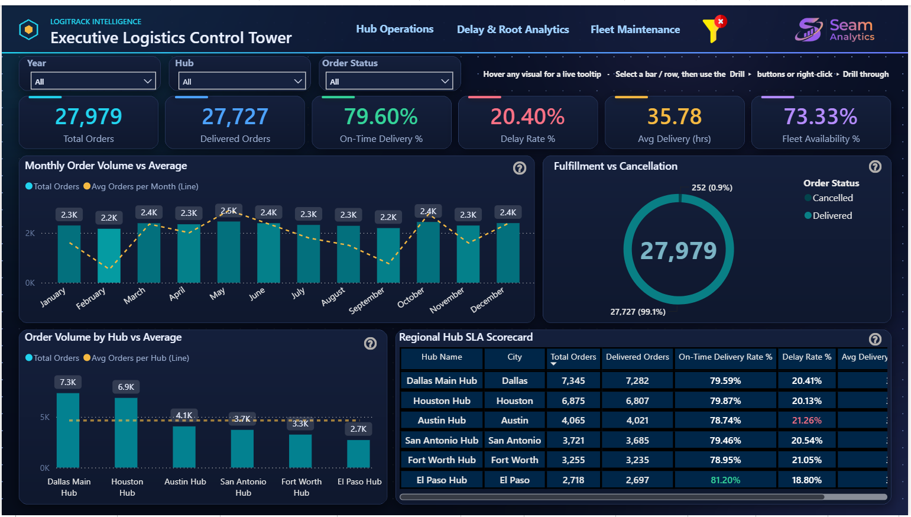
  <p><em>Figure 1: Executive Control Tower — Strategic SLA Performance, Order Trends, and Hub Compliance.</em></p>
</div>

---

### Page 2: Regional Hub Operations
*Audience: Regional Distribution Directors, Terminal Managers, Shift Supervisors*

The **Regional Hub Operations** page provides deep operational visibility into facility throughput, intake velocity, dispatch cadence, and capacity bottlenecks across the six Texas hubs (**Dallas Main, Houston, Austin, San Antonio, Fort Worth, El Paso**).

- **Operational KPI Ribbon**:
  - **Active Texas Hubs**: 6 primary logistics facilities.
  - **Network Daily Capacity**: Aggregate maximum truckload/package rating.
  - **Average Processing Dwell Time**: Mean hours spent in sortation and cross-docking.
  - **Inbound Volume Received**: Total intake volume processed.
  - **Outbound Volume Dispatched**: Completed carrier dispatches.
  - **Active Backlog Queue**: Real-time staging backlog awaiting transport.
- **Analytical Visuals**:
  - **Texas Spatial Distribution & Volume Map**: Geographic visualization displaying hub nodes sized by volume throughput.
  - **Designed Capacity vs. Processed Volume (Clustered Column Chart)**: Benchmarks facility capacity against peak order volumes.
  - **24-Hour Network Intake vs. Dispatch Rhythm (Dual-series Line Chart)**: Tracks hourly sortation waves to identify shift bottlenecks.
  - **Hub Processing Performance Scorecard**: Granular matrix evaluating processing speeds, backlog accumulation, and utilization percentages.

<div align="center">
  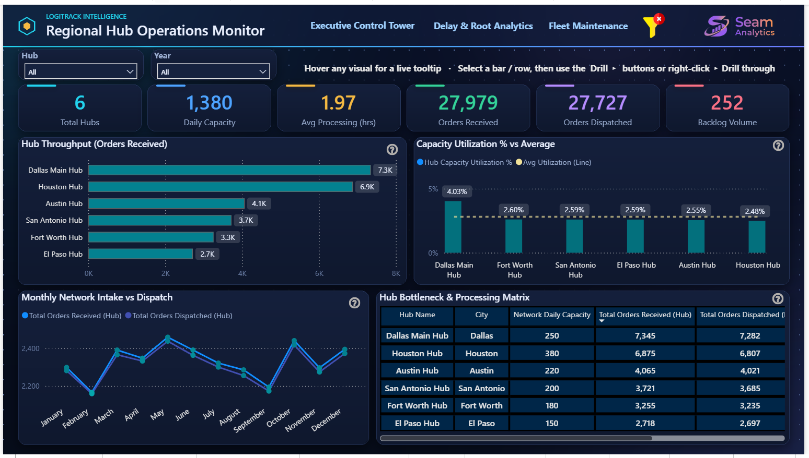
  <p><em>Figure 2: Regional Hub Operations — Spatial Texas Network, Capacity Utilization, and 24-Hour Rhythm.</em></p>
</div>

---

### Page 3: Delay & Root-Cause Analytics
*Audience: Continuous Improvement Leads, Customer Experience Managers, Logistics Analysts*

The **Delay & Root-Cause Analytics** page isolates operational failures, attributes late deliveries to verifiable root causes, and benchmarks driver and equipment performance.

- **Delay KPI Ribbon**:
  - **Late Deliveries**: 5,653 delayed orders.
  - **Delay Rate %**: 20.40% network delay incidence.
  - **Average Delayed Duration**: Mean transit duration for late shipments.
  - **Delivery SLA Variance**: Net hours added by delays compared to on-time shipments.
  - **Total Delay Incidents**: Categorized occurrences across all verified delay reasons.
  - **Total Fulfilled Orders**: 27,727 delivered baseline denominator.
- **Analytical Visuals**:
  - **Pareto Delay Reason Distribution (Pareto Bar + Line Chart)**: Ranks delay categories with an 80% cumulative threshold line (**Traffic Congestion, Severe Weather, Mechanical Breakdown, Warehouse Sortation Delay, Route Detour, Dispatch Lag, Inspection Dwell, Staging Queue, Border Check, Documentation Hold**).
  - **Delay Rate by Vehicle Classification (Horizontal Bar Chart)**: Compares failure rates across Cargo Vans, Box Trucks, Semi-Trailers, and Flatbeds.
  - **Driver Performance Matrix (Scatter Plot)**: Driver Seniority (Experience in Years) vs. On-Time Delivery Rate (%).
  - **Delay Incident Feed & ML Risk Predictions (Table)**: Detailed order-level audit trail displaying order IDs, hubs, delay reasons, and real-time XGBoost risk scores.

<div align="center">
  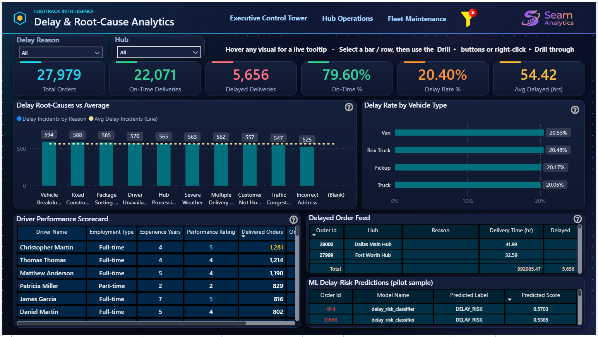
  <p><em>Figure 3: Delay & Root-Cause Analytics — Pareto Root-Cause Breakdown, Vehicle Risk, and Driver Leaderboard.</em></p>
</div>

---

### Page 4: Fleet Telematics & Predictive Maintenance
*Audience: Fleet Asset Managers, Maintenance Supervisors, Safety Directors*

The **Fleet Telematics & Predictive Maintenance** page delivers asset health monitoring across all 45 commercial vehicles (V001–V045), tracking maintenance financial expenditures, vehicle downtime, and mechanical risk indicators.

- **Fleet Health KPI Ribbon**:
  - **Total Fleet Inventory**: 45 commercial vehicles.
  - **Active Road-Ready Units**: Vehicles available for immediate assignment.
  - **Depot Maintenance Units**: Out-of-service vehicles undergoing repair.
  - **Critical Risk Alerts**: High-risk assets flagged by predictive telemetry.
  - **Total Maintenance Spend**: Cumulative parts, labor, and servicing expenditures.
  - **Total Equipment Downtime**: Cumulative hours lost to mechanical servicing.
- **Analytical Visuals**:
  - **Fleet Operational Availability (Donut Chart)**: Active Road-Ready vs. In-Maintenance availability ratio.
  - **Asset Longevity vs. Lifetime Breakdowns (Scatter Plot)**: Vehicle Age in Days vs. Lifetime Mechanical Failures.
  - **Maintenance Expense by Service Type (Horizontal Bar Chart)**: Financial spend segmented across **Transmission, Brakes, Tires, Oil Change, Electrical**.
  - **High-Risk Vehicle Fleet Action Watchlist (Table)**: Actionable vehicle table displaying odometer risk alerts, breakdown histories, and maintenance status.

<div align="center">
  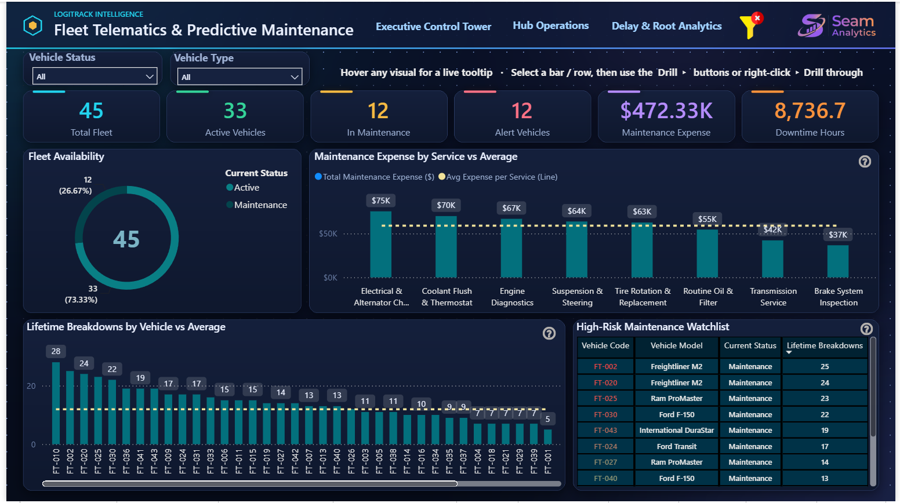
  <p><em>Figure 4: Fleet Telematics & Maintenance — Fleet Availability, Repair Spend, and Risk Watchlist.</em></p>
</div>

---

## 3. Dedicated Drill-Through Analysis Pages

The report features **8 dedicated Drill-Through Pages** that allow users to right-click any visual element and navigate directly to focused deep-dive investigations:

| Drill-Through Page | Target Entity | Key Insights & Investigated Dimensions | Screenshot |
|---|---|---|---|
| **Drill Hub** | Regional Hub | Facility throughput, local driver roster, vehicle allocations, and hourly bottlenecks. | 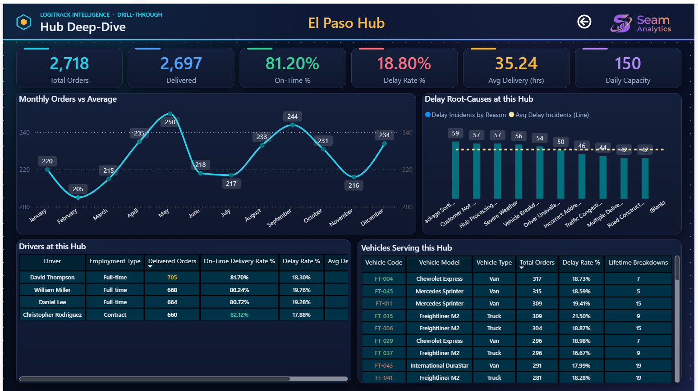 |
| **Drill Driver** | Delivery Driver | Driver delivery history, lifetime OTD%, CSAT ratings, and assigned vehicles. | 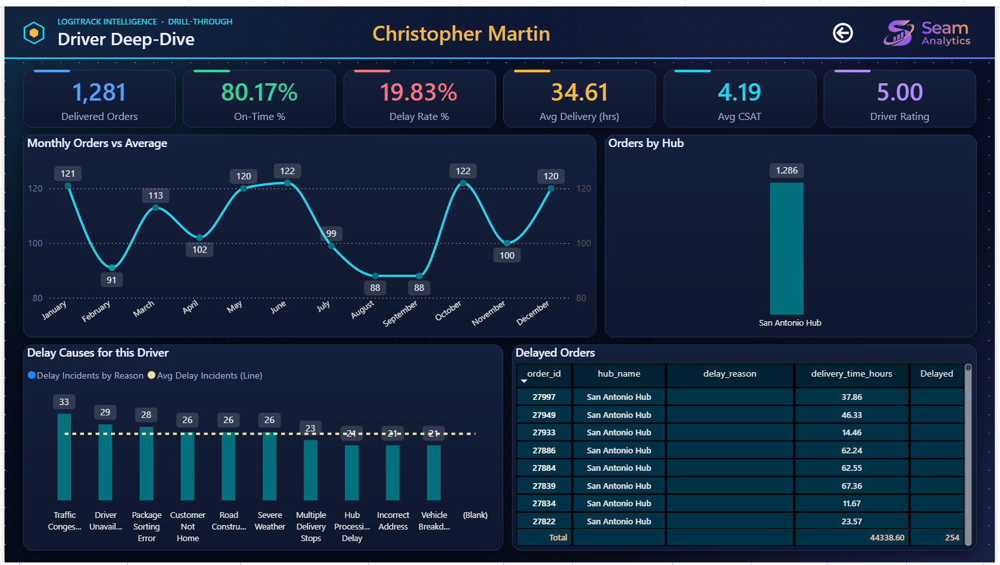 |
| **Drill Vehicle** | Specific Vehicle | Odometer history, lifetime breakdown log, maintenance work orders, and fuel efficiency. | 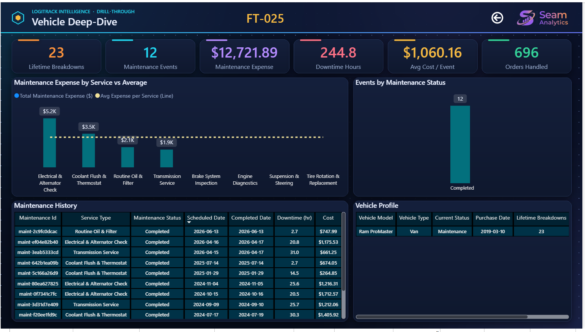 |
| **Drill Vehicle Type** | Vehicle Class | Class-level delay rates, operating cost per mile, and maintenance spend across fleet classes. | 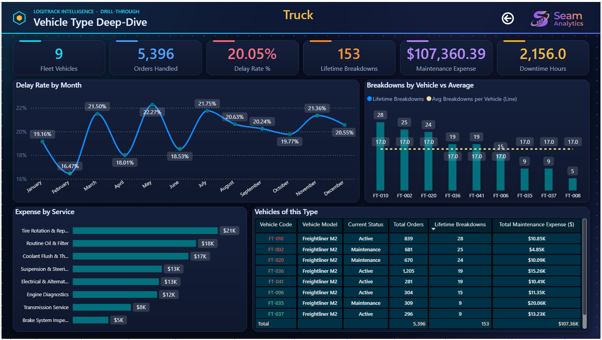 |
| **Drill Month** | Calendar Month | Monthly order volume pacing, seasonal surge dynamics, and month-over-month variance. | 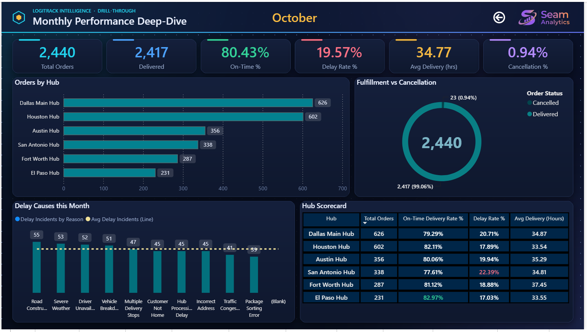 |
| **Drill Order Status** | Order Status | Deep-dive into Delivered vs. Cancelled orders, transit duration spreads, and lost revenue. | 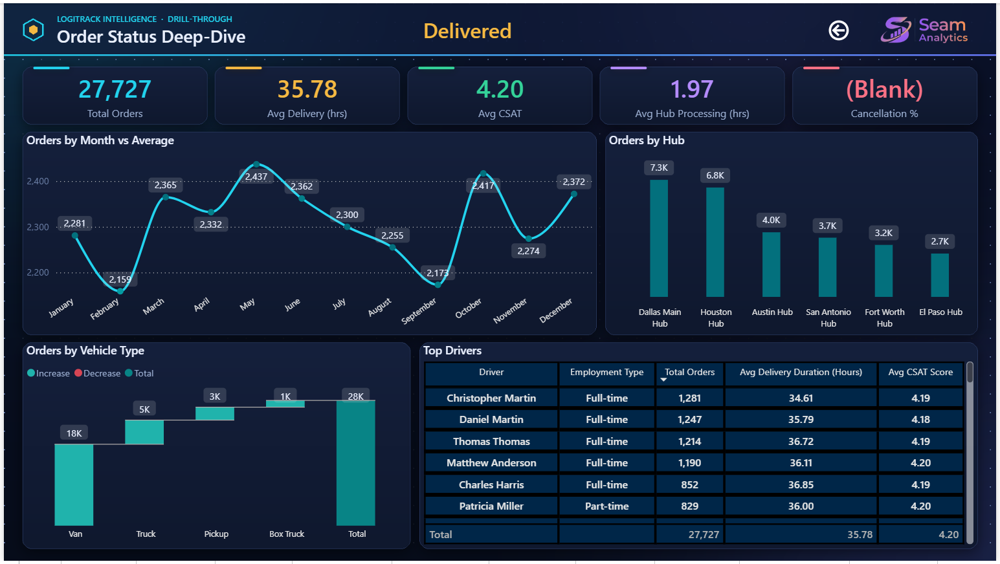 |
| **Drill Delay Reason** | Root Cause | Weather, traffic, and mechanical failure incidence, affected hubs, and SLA impact. | 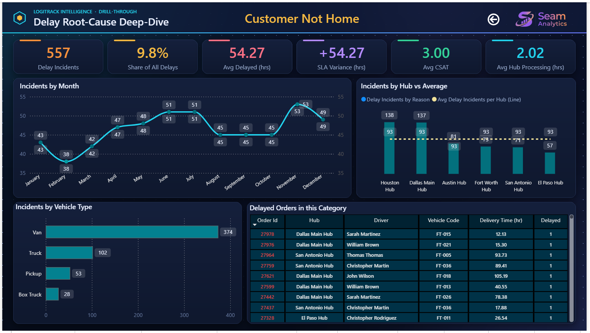 |
| **Drill Service** | Maintenance Type | Transmission, brake, tire, and electrical repair costs, vendor performance, and downtime. | 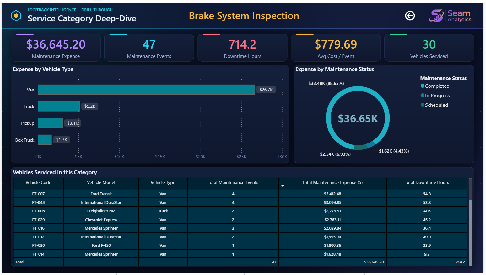 |

---

## 4. Modern Interactive Tooltip Pages

To minimize visual clutter while maximizing insight density, the suite includes **10 dynamic report tooltip pages** that render customized micro-dashboards upon hovering over data points:

1. **Tooltip KPI Pulse**: Micro-sparklines and target variance for executive metrics.
2. **ToolTip Hub**: Facility capacity gauges and active backlog volume.
3. **Tooltip Driver**: Driver profile summary, rating badge, and historical OTD rate.
4. **Tooltip Vehicle**: Odometer readings, next service countdown, and current status.
5. **Tooltip Vehicle Type**: Fleet composition and active availability ratio.
6. **Tooltip Delay Reason**: Historical impact, percentage share, and affected transport lanes.
7. **Tooltip Service**: Average repair cost, mean downtime duration, and frequency.
8. **Tooltip Status**: Volume proportions and customer satisfaction ratings.
9. **Tooltip Month**: MoM growth percentages and seasonal benchmarks.
10. **Tooltip Fleet**: Fleet depot distribution and maintenance alert counters.

*(All tooltip screenshots are available in the [LogiTrack_Analytics/Dashboard_Images/](LogiTrack_Analytics/Dashboard_Images/) directory).*

---

## 5. Tabular Semantic Model & Star-Schema Architecture

The semantic model is engineered in native **Tabular Model Definition Language (TMDL)** under `LogiTrack_Analytics_(pbip).SemanticModel/definition/`. It implements a pristine Star Schema eliminating circular dependencies and bi-directional ambiguity:

```
                          ┌─────────────────┐
                          │     DimDate     │
                          └────────┬────────┘
                                   │ 1
                                   │
                                   │ * (order_date_key)
┌──────────────┐          ┌────────▼────────┐          ┌─────────────────┐
│    DimHub    │1        *│   FactOrders    │*        1│    DimDriver    │
│              ├──────────►                 ◄──────────┤                 │
└──────────────┘(hub_key) └────────┬────────┘(driver_key)└─────────────────┘
                                   │ * (vehicle_key)
                                   │
                                   │ 1
                          ┌────────▼────────┐
                          │   DimVehicle    │
                          └────────┬────────┘
                                   │ 1
                                   │
                                   │ * (vehicle_key)
                          ┌────────▼────────┐
                          │ FactMaintenance │
                          └─────────────────┘
```

### Table Catalog & Record Counts:
1. **`FactOrders`** (27,979 rows): Central order fulfillment fact storing delivery times, hub processing hours, SLA flags, CSAT ratings, and delay categories.
2. **`FactHubHourly`** (Hourly operational fact): Inbound intake, dispatches, backlog volume, and capacity utilization percentages.
3. **`FactMaintenance`** (Historical work orders): Service ticket records, repair costs, vehicle downtime hours, and service categories.
4. **`FactMLPredictions`** (Real-time inference feed): Predicted delay labels (`DELAY_RISK`, `ON_TIME`), probability scores, and model metadata.
5. **`DimHub`** (6 Texas distribution nodes): Hub names, Texas geographic coordinates, designed daily capacities, and operating hours.
6. **`DimVehicle`** (45 commercial fleet assets): Vehicle identification codes, types, models, purchase dates, and mechanical breakdown histories.
7. **`DimDriver`** (55 commercial drivers): Driver names, home base hubs, employment classifications, experience years, and ratings.
8. **`DimDate`** (Calendar dimension): Full date hierarchy (Year, Quarter, Month, Week, Day of Week, Weekend flags).
9. **`_Measures`**: Dedicated disconnected calculation table housing all 37+ production DAX measures.

---

## 6. Production DAX Measures Catalog

All DAX logic is authored in compliance with enterprise BI best practices and documented in [dax_measures.txt](dax_measures.txt):

- **01 - Executive KPIs**: `Total Orders`, `Delivered Orders`, `Cancelled Orders`, `Cancellation Rate %`, `On-Time Delivery Rate %`, `Delay Rate %`, `Avg Delivery Duration (Hours)`, `Avg CSAT Score`, `Total Orders (Prior Month)`, `Order Volume MoM Growth %`.
- **02 - Delivery & SLAs**: `On-Time Deliveries`, `Delayed Deliveries`, `Avg Delayed Duration (Hours)`, `Avg On-Time Duration (Hours)`, `Delivery SLA Variance (Hours)`, `Delay Incidents by Reason`, `Cumulative Delay Reason %`, `Delay Share %`.
- **03 - Hub Operations**: `Total Hubs`, `Network Daily Capacity`, `Avg Hub Processing Time (Hours)`, `Total Orders Received (Hub)`, `Total Orders Dispatched (Hub)`, `Total Backlog Volume`, `Hub Capacity Utilization %`, `Avg Daily Orders`.
- **04 - Fleet & Maintenance**: `Total Fleet Vehicles`, `Active Vehicles`, `Vehicles In Maintenance`, `Fleet Availability Rate %`, `Maintenance Alert Vehicles`, `Avg Fleet Age (Days)`, `Total Maintenance Events`, `Total Maintenance Expense ($)`, `Total Downtime Hours`, `Lifetime Breakdowns`, `Avg Cost per Maintenance Event`, `Vehicles Serviced`.
- **05 - Driver Metrics**: `Total Drivers`, `Avg Driver Experience (Years)`, `Avg Driver Rating`, `Driver Completed Deliveries`.
- **06 - Benchmark Reference Lines**: 12 dedicated horizontal benchmark measures for dynamic chart reference thresholds.
- **07 - Dynamic Visual Formatting**: 7 conditional color measures driving heatmap highlights and high-risk font coloring.
- **08 - Slicer Selection Context**: 8 dynamic context measures powering title banners on drill-through pages.

---

## 7. Master Corporate Theme: LogiTrack Midnight Premium

The visual design is governed by [LogiTrack_Premium_Theme.json](LogiTrack_Premium_Theme.json), implementing an ultra-modern dark-mode palette tailored for 24/7 operations control rooms:

| Theme Token | HEX Code | Design Role & Application |
|---|---|---|
| **Primary Accent / Cyan** | `#22D3EE` | Key callout values, active slicer selections, table total rows |
| **Primary Indigo** | `#6C7BFF` | Bar and column charts, volume distributions |
| **Success Emerald** | `#34D399` | On-time delivery SLA compliance, healthy utilization |
| **Warning Amber** | `#F5B942` | Approaching capacity thresholds, moderate risk |
| **Danger Rose / Red** | `#FB7185` | Delayed shipments, critical telemetry alerts, breakdown risks |
| **Primary Background** | `#111B34` | Main report card container backgrounds |
| **Page Outspace** | `#0F172A` | Global canvas background |
| **Secondary Background** | `#1A2748` | Table column headers, drill-through card containers |
| **Primary Text** | `#EAF0FF` | High-contrast callout metrics and visual titles |
| **Secondary Text** | `#9DB0D3` | Category labels, axis titles, gridline annotations |

---

## 8. How to Open and Refresh the Report in Power BI Desktop

### Option A: Open via PBIP Project (Recommended for Version Control & Git)
1. Launch **Microsoft Power BI Desktop** (October 2026 release or newer recommended).
2. Go to **File -> Open report -> Browse reports**.
3. Navigate to:
   ```
   dashboards/powerbi/LogiTrack_Analytics/
   ```
4. Select **`LogiTrack_Analytics_(pbip).pbip`** and click **Open**.
5. Power BI Desktop automatically loads the TMDL semantic model, binds the data from `data_export/`, and renders all 4 main dashboard pages, 8 drill pages, and 10 tooltips.

### Option B: Open via Standalone PBIX File
1. In Windows Explorer, double-click:
   ```
   dashboards/powerbi/LogiTrack_Analytics/LogiTrack_Analytics_Final.pbix
   ```
2. The standalone binary file opens instantly with all data pre-cached.

### Refreshing Data from Upstream Lakehouse:
1. Export refreshed warehouse tables to `data_export/` using the automated export pipeline:
   ```powershell
   .venv\Scripts\python.exe scripts/pbi_stage3_export_data.py
   ```
2. In Power BI Desktop, navigate to the **Home** ribbon and click **Refresh**.
3. All visual cards, charts, and drill pages refresh simultaneously.

---

<div align="center">
  <sub>LogiTrack Intelligence Enterprise Power BI Analytics Suite • Authored by Ryadul Islam Seam • © 2026</sub>
</div>
